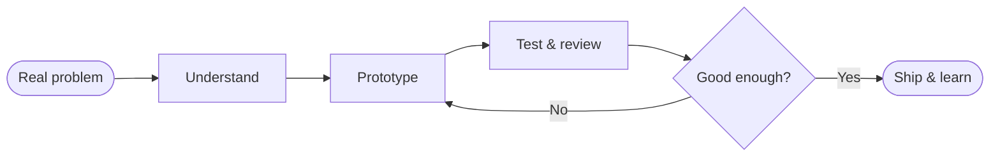

<div align="center">


<br/>


<br/><br/>

<a href="https://github.com/srinivaspalnati22-png"></a>
<a href="https://www.linkedin.com/in/palnati-pushpa-naga-venkata-srinivas-661744413"></a>
<a href="https://leetcode.com/u/srinivaspalnati22-png/"></a>
<a href="https://www.hackerrank.com/profile/srinivaspalnati1"></a>
<a href="mailto:srinivaspalnati22@gmail.com"></a>

</div>

<br/>

## `01` &nbsp;About

<table>
<tr>
<td width="58%" valign="top">

Hi, I'm **Palnati Pushpa Naga Venkata Srinivas**, a computer science engineer working at the intersection of **AI, machine learning and software development**.

I like problems that matter to real people. My loop is simple: **understand the problem, build a solution, then improve it through experimentation.**

- Building intelligent, practical applications
- Exploring AI/ML alongside full-stack engineering
- Learning new tools by shipping real projects
- Designing technology around real-world needs

</td>
<td width="42%" valign="top">

```ts
const srinivas = {
  role:     "Computer Science Engineer",
  focus:    ["AI / ML", "Full-Stack"],
  builds:   "Intelligent applications",
  method:   "Learn → Build → Improve",
  mindset:  "Curious by default",
  openTo:   "Opportunities & collaboration",
};
```

</td>
</tr>
</table>

---

## `02` &nbsp;Featured Project

<div align="center">


</div>

RESQONE AI brings life-critical support workflows together in **one connected experience.**

<table>
<tr>
<td width="50%" valign="top">

**Core workflows**

| | |
|---|---|
| 🚑 | Emergency assistance |
| 🏥 | Hospital coordination |
| 📍 | Ambulance tracking |
| 🩸 | Blood-donor matching |
| 🐍 | Snakebite-support workflow |
| 🤝 | Volunteer network |

</td>
<td width="50%" valign="top">

**Built with**


<br/><br/>

<a href="https://resqone-ai-app.vercel.app/"></a>
<a href="https://github.com/srinivaspalnati22-png/RESQONE-AI"></a>

</td>
</tr>
</table>

---

## `03` &nbsp;Project Lab

<table>
<tr>
<td width="33%" valign="top">

#### 🧬 Pulsevein
*Multimodal deepfake detection*

Identifying manipulated media and analysing the authenticity of digital content.

`AI / ML` `Media Analysis`

</td>
<td width="33%" valign="top">

#### 🛡️ TrustShield AI
*Scam & phishing detection*

Spotting suspicious content and online threats to keep users safe.

`AI` `Digital Safety`

</td>
<td width="33%" valign="top">

#### 🎯 CareerSafe
*Career safety intelligence*

A job-scam detector that helps users assess suspicious offers and career messages.

`Python` `Flask` `JavaScript`

</td>
</tr>
<tr>
<td width="33%" valign="top">

#### 🏙️ SmartCivic AI
*Intelligent civic reporting*

Accessible issue reporting with AI-assisted civic workflows.

`AI` `Civic Tech`

</td>
<td width="33%" valign="top">

#### 🔎 TruthLens AI
*Information integrity*

Fake-news detection and evaluation of potentially misleading information.

`AI / ML` `Text Analysis`

</td>
<td width="33%" valign="top">

#### 📊 NexusAI
*Retail forecasting*

Predictive analytics that supports smarter retail planning.

`Analytics` `Forecasting`

</td>
</tr>
</table>

---

## `04` &nbsp;How I Work



<table>
<tr>
<td width="25%" align="center" valign="top">

**🎯 Purpose First**

Start with the problem, not just the technology.

</td>
<td width="25%" align="center" valign="top">

**🔨 Learn by Building**

Turn concepts into prototypes and working projects.

</td>
<td width="25%" align="center" valign="top">

**🔁 Iterate Deliberately**

Test, review, refine, and improve.

</td>
<td width="25%" align="center" valign="top">

**🛡️ Build Responsibly**

Consider usability, reliability, and real-world impact.

</td>
</tr>
</table>

---

## `05` &nbsp;Tech Stack

<div align="center">

| Layer | Tools |
|:--|:--|
| **Languages** |  |
| **Frontend** |  |
| **Backend** |  |
| **AI · Data · Platforms** |  |
| **Developer Tools** |  |

</div>

---

## `06` &nbsp;GitHub Analytics

<div align="center">


<br/><br/>


<br/><br/>


</div>

---

## `07` &nbsp;Milestones

<table>
<tr>
<td align="center" width="25%" valign="top">

### 🥇
**First Prize**<br/>5-hour hackathon

</td>
<td align="center" width="25%" valign="top">

### 🚀
**5+ Hackathons**<br/>Participated in

</td>
<td align="center" width="25%" valign="top">

### 🧠
**Project Builder**<br/>Multiple AI and software projects

</td>
<td align="center" width="25%" valign="top">

### 📚
**Lifelong Learner**<br/>Multiple technical certifications

</td>
</tr>
</table>

---

<div align="center">

## Have a problem worth solving?

**Let's connect around AI, software engineering, creative problem-solving and useful products.**

<br/>

<a href="mailto:srinivaspalnati22@gmail.com"></a>
<a href="https://www.linkedin.com/in/palnati-pushpa-naga-venkata-srinivas-661744413"></a>
<a href="https://leetcode.com/u/srinivaspalnati22-png/"></a>
<a href="https://www.hackerrank.com/profile/srinivaspalnati1"></a>

<br/><br/>

<sub>Designed around curiosity · Built through engineering · Driven by impact</sub>


</div>
